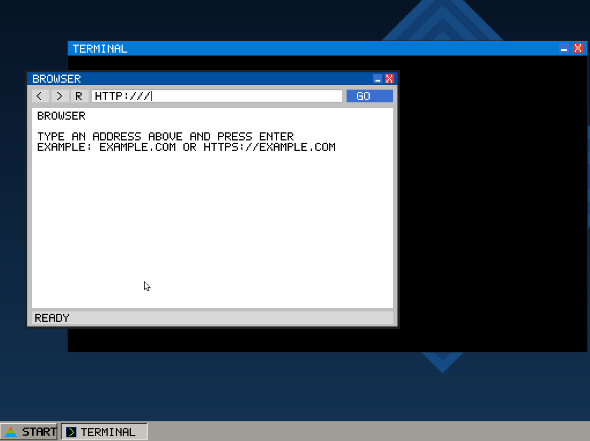

# neutra os

neutra is a small 32-bit operating system project for x86. it boots with grub using the multiboot2 protocol and is built as a freestanding kernel.

## requirements

on ubuntu or wsl, install the build tools and emulator:

```bash
sudo apt update
sudo apt install build-essential make nasm binutils gcc-i686-linux-gnu grub-pc-bin grub-common xorriso mtools qemu-system-x86
```

in particular, the makefile expects:

- `i686-linux-gnu-gcc` for compiling 32-bit freestanding c code
- `i686-linux-gnu-ld` for linking the kernel
- `nasm` for assembling x86 boot and sound code
- `gcc` for building the host-side fat12 image tool
- `grub-mkrescue` and `xorriso` for creating the bootable iso
- `qemu-system-i386` to run the iso in an emulator

## build

run these commands from the project root, the folder containing `Makefile`:

```bash
make
```

this compiles the boot code and kernel objects, then links them into `kernel.elf`.

create the bootable iso and fat disk image with:

```bash
make iso
```

this creates `os.iso` and `disk.img`. the iso contains the kernel, grub configuration, and kernel memory modules

## run

start the os in qemu:

```bash
make run-iso
```

on windows through wsl, `make run-win` uses the qemu executable configured in the makefile at `/mnt/c/Program Files/qemu/qemu-system-i386.exe` change `QEMU_WIN` in `Makefile` if qemu is installed elsewhere

## clean build files

```bash
make clean
```

removes compiled objects, `kernel.elf`, `os.iso`, and the temporary fat image builder to also remove `disk.img`, run:

```bash
make distclean
```

## updates

### version 0.4

- added core kernel components, including the shell, interrupts, scheduling, disk and fat support
- added the initial kernel memory module structure

### version 0.8

- expanded the archived system with a disk image and additional project content
- continued development of the kernel shell and system components
- added vga graphics

### version 0.9

- added a graphical desktop with a menu and taskbar
- added built-in programs including a browser, editor, explorer, cde, and developer tool
- added javascript, dom, css, cookie, and png image code
- added pci and rtl8139 networking, tcp, dns, http, tls, and mbedtls sources
- added sound and usb modules
- added grub iso creation with a fat12 disk image and kernel memory modules
- added dce programming language
- added dce to cde compiler
- added developer
- added brush
- uhh brush

## screenshots

### Neutra OS 0.4


### Neutra OS 0.8


### Neutra OS 0.9


